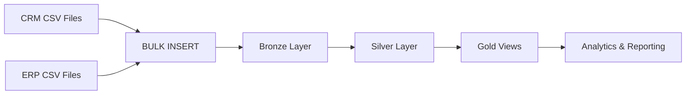

# SQL Server Data Warehouse

A SQL Server data warehouse project that integrates CRM and ERP data through **Bronze, Silver, and Gold layers** using T-SQL.

## Architecture

## Workflow

1. **Ingest:** Load CRM and ERP CSV data into Bronze tables using `BULK INSERT`.
2. **Automate:** Use stored procedures to refresh Bronze data.
3. **Transform:** Clean and standardize data in Silver tables.
4. **Integrate:** Create Gold views for customer, product, and sales analysis.
5. **Validate:** Run SQL checks for duplicates, missing values, inconsistent categories, invalid dates, and sales calculations.

## Gold Layer Data Model

The Gold layer contains three views:

- **`gold.dim_customers`** — Customer details integrated from CRM customer data and ERP customer/location information.
- **`gold.dim_products`** — Product details enriched with ERP product category information.
- **`gold.fact_sales`** — Sales transactions linked to customer and product dimensions.

### Star Schema

**Relationships**
- `gold.fact_sales.customer_key` → `gold.dim_customers.customer_key`
- `gold.fact_sales.product_key` → `gold.dim_products.product_key`

**Sales calculation:** `sales_amount = quantity * price`

## Source Integration

- **CRM:** `crm_sales_details`, `crm_prd_info`, `crm_cust_info`
- **ERP:** `erp_px_cat_g1v2`, `erp_cust_az12`, `erp_loc_a101`

CRM sales and product/customer records are integrated with ERP product-category, customer birthdate, and customer-country information.

## medallion architecture data flow diagram

## Tech Stack

- Microsoft SQL Server
- T-SQL
- Stored procedures
- `BULK INSERT`
- Views and dimensional modeling
- SQL data-quality checks

## Key Skills

SQL ETL · CRM/ERP data integration · Data cleansing · Load automation · Data validation · Star-schema modeling

