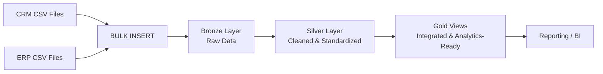
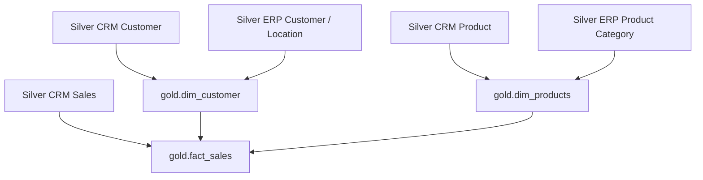

# SQL Server Data Warehouse

An end-to-end **SQL Server data warehouse** built with T-SQL to integrate CRM and ERP data, automate ingestion, transform data across Bronze and Silver layers, and prepare business-ready Gold views for analytics.

## Architecture

## End-to-End Workflow

1. **Database setup** — Create `DataWarehouse` and the `bronze`, `silver`, and `gold` schemas.
2. **Bronze ingestion** — Load six CRM/ERP CSV datasets using `BULK INSERT`.
3. **Load automation** — Use stored procedures for truncate-and-load refreshes and track load progress and duration.
4. **Silver transformation** — Clean and standardize data, handle invalid dates and categories, derive product attributes, and add load metadata.
5. **Gold integration** — Create views that combine refined CRM and ERP data for downstream analytics.
6. **Validation** — Check duplicates, missing keys, data consistency, and product-key integrity.

## Gold Layer Data Model

The Gold layer exposes **views rather than physical tables**:

- `gold.dim_customer` — Integrated customer dimension using CRM and ERP customer attributes.
- `gold.dim_products` — Product dimension enriched with product-category information; filters to current products (`prd_end_dt IS NULL`) where applicable.
- `gold.fact_sales` — Sales fact view joining sales records to customer and product dimensions, with generated surrogate keys for dimensional relationships.

*Conceptual relationship diagram. Confirm exact join keys and column names against the SQL scripts.*

## Data Quality Checks

- Duplicate customer and product identifiers
- Missing or NULL keys
- Product-key uniqueness and referential integrity
- Inconsistent categories and whitespace
- Invalid dates and sales-value consistency

## Tech Stack

- Microsoft SQL Server
- T-SQL and stored procedures
- `BULK INSERT`
- Views and dimensional modeling
- CRM and ERP CSV datasets

## Key Skills Demonstrated

SQL-based ETL · Data integration · Data cleansing · Full-load automation · Data quality validation · Dimensional modeling · Fact and dimension views

> **Note:** The setup script may drop and recreate `DataWarehouse`. Run it only in a disposable development environment after confirming that no required data will be lost.
